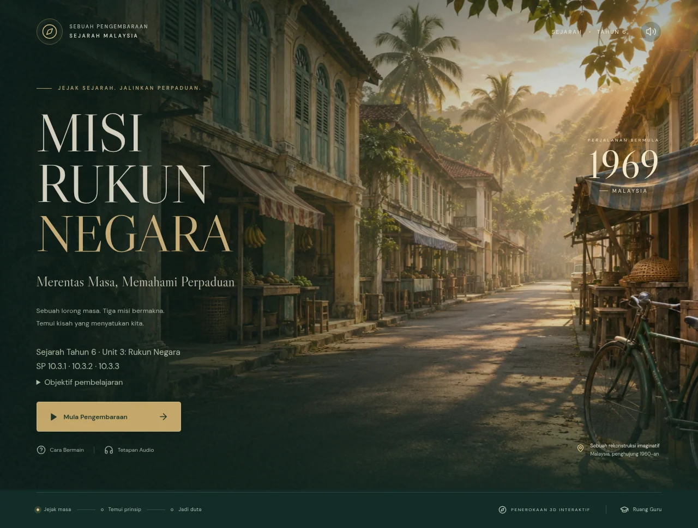
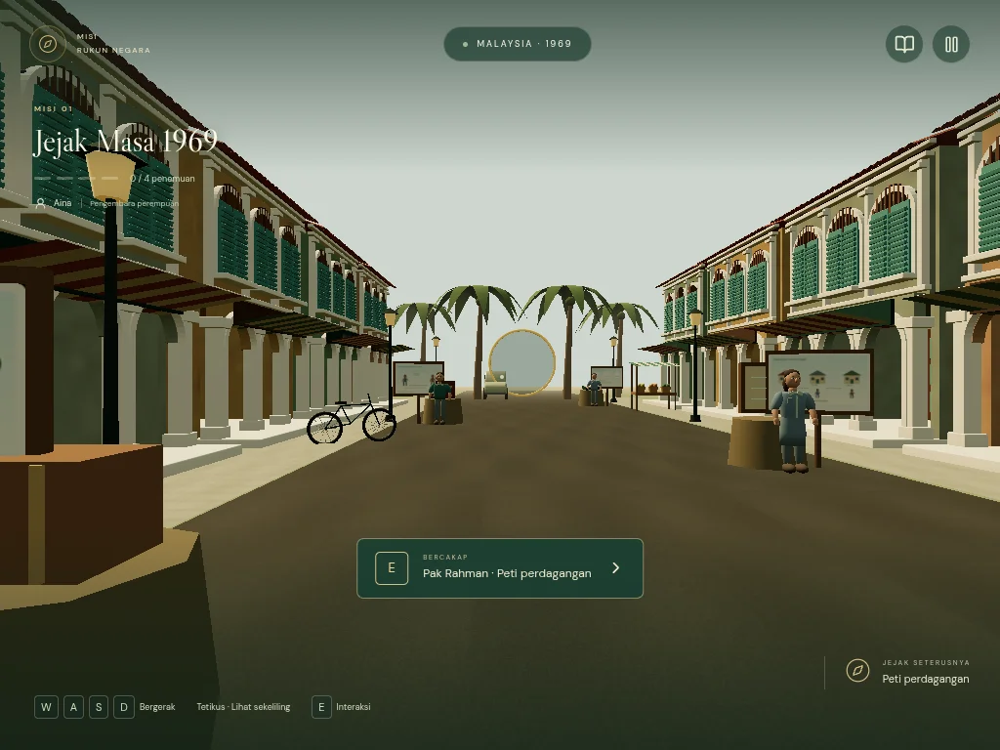
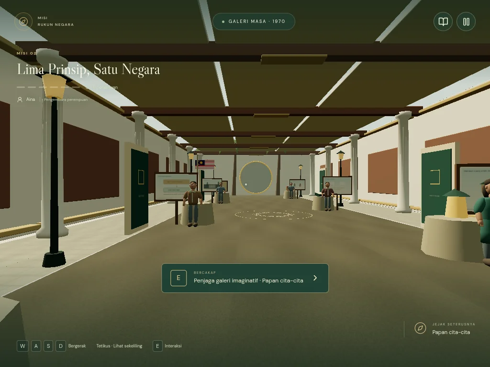
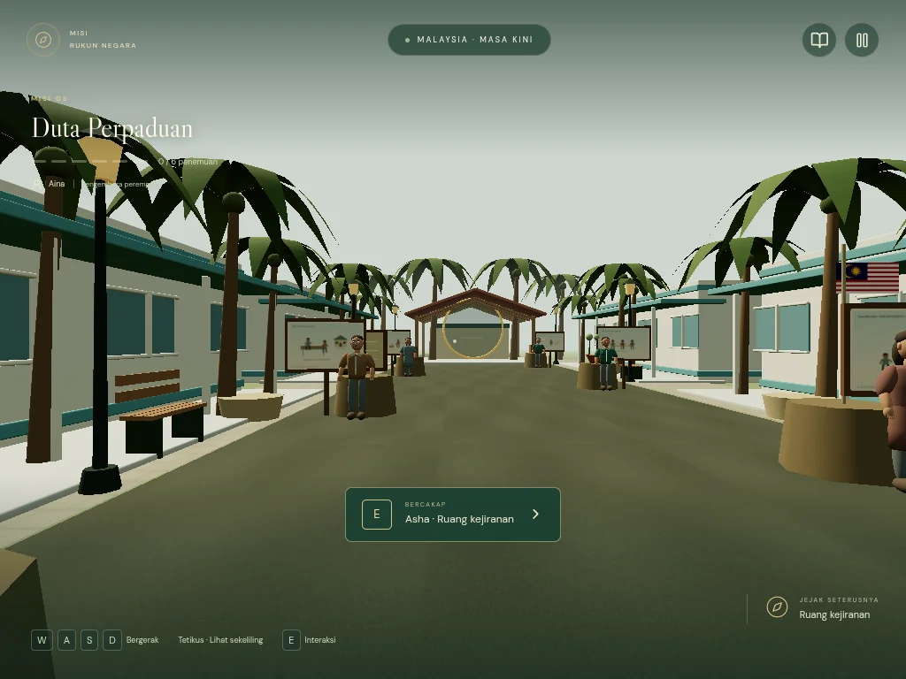

# Misi Rukun Negara

**Pengembaraan Merentas Masa** — permainan penerokaan orang pertama untuk Sejarah Tahun 6, Unit 3, SP 10.3.1–10.3.3.

Repository: https://github.com/khiewxinru-ui/khiewxinru-ui-misi-rukun-negara

Website GitHub Pages: https://khiewxinru-ui.github.io/khiewxinru-ui-misi-rukun-negara/

Deployment GitHub Pages telah berjaya. Status penerbitan seterusnya boleh disemak pada tab **Actions**. Teacher Editor dalam talian memerlukan konfigurasi backend berasingan.

## Paparan sebenar

Menu permainan:



Persekitaran 3D dalam pelayar:







## Menjalankan projek

Gunakan Node.js 24 dan npm.

```sh
npm ci
npm run dev
```

Buka URL yang dipaparkan oleh Vite. Untuk binaan pengeluaran:

```sh
npm test
npm run build
npm run preview
```

Semua aset permainan dan fon dihoskan bersama website. Sambungan Internet diperlukan untuk memuatkan website; selepas dimuatkan, interaksi pelajar tidak memerlukan akaun atau panggilan API berbayar. Tiada Vercel digunakan.

## Cara bermain

1. Pilih **Mula Pengembaraan**, pilih watak dan masukkan nama panggilan.
2. Masuki lorong masa dan baca arahan misi.
3. Komputer: **W A S D** / anak panah atas-bawah untuk bergerak, tetikus atau anak panah kiri-kanan untuk melihat. Klik dunia untuk mengunci tetikus; **Esc** melepaskannya.
4. Dekati penanda emas, kemudian tekan **E** atau butang interaksi.
5. Baca atau dengar penemuan. Selesaikan padanan, susunan dan pilihan situasi.
6. Lengkapkan aktiviti misi untuk membuka misi seterusnya. Tiada had masa.
7. Buku pengembaraan merekodkan pengetahuan yang telah ditemui. Nama, kemajuan dan refleksi disimpan pada peranti yang sama.

Telefon/tablet: gunakan joystick dan leret dunia untuk melihat. Kualiti grafik rendah boleh dipilih dalam tetapan. Ujian emulasi telefon tidak menggantikan penilaian prestasi pada telefon fizikal sekolah.

Teks pembelajaran diperbesar: dialog dan soalan sekitar 20 px pada komputer, dialog 18 px pada telefon, serta jawapan/petunjuk/catatan 17–18 px. Dialog panjang boleh ditatal tanpa memendekkan kandungan sejarah.

## Tiga misi

| Misi                      | Aktiviti | Kandungan                                           |
| ------------------------- | -------- | --------------------------------------------------- |
| Jejak Masa 1969           | 4        | Tiga petunjuk dan pentaksiran tiga sebab pengenalan |
| Lima Prinsip, Satu Negara | 6        | Lima matlamat dan lima cabaran prinsip              |
| Duta Perpaduan            | 6        | Enam peranan Rukun Negara dalam situasi kehidupan   |

Kandungan disemak daripada halaman **bercetak 36–46** buku teks yang dinyatakan dalam prompt. Watak dan dialog pendidikan ialah rekaan. Galeri ialah ruang imaginatif. Rekonstruksi visual tidak didakwa sebagai rakaman atau pembinaan semula tepat sebuah lokasi sebenar.

[Pemetaan kandungan dan pentaksiran](docs/content-map.md) · [Master prompt](docs/MASTER-PROMPT.md)

## Pemerhatian visual dan pentaksiran akhir

Setiap satu daripada 16 penemuan mempunyai album yang berkaitan dengan isi pelajaran. 21 imej unik digunakan dalam 27 konteks aktiviti: dua foto arkib, 18 rajah asal dan imej Jalur Gemilang. Murid melihat gambar di papan 3D, membuka album NPC, membesarkan gambar, menyemak kapsyen/sumber, mendengar penerangan dan menjawab soalan pemerhatian. Respons serta catatan disimpan ke Buku Pengembaraan selepas penemuan diselesaikan.

Foto getah bertarikh sekitar **1910**, manakala tarikh rakaman foto bijih timah **tidak dinyatakan**. Kedua-duanya tidak dipersembahkan sebagai foto 1969. Garis masa MAGERAN/13 Mei/31 Ogos 1970 dan situasi masyarakat ialah **ilustrasi pendidikan**, bukan foto atau keratan akhbar sebenar. Tiada visual keganasan. [Pemetaan dan sumber visual](docs/visual-learning.md).

Video pembukaan menggunakan [pautan yang diberikan pemilik](https://www.youtube.com/watch?v=2FgimpUv8q8), dengan embed YouTube, pautan asal dan pilihan teruskan. Tiada salinan video dimuat turun. Ketersediaan embed, kawalan dan sari kata tertakluk kepada YouTube serta pemilik video.

Selepas tiga misi, **Pentaksiran Akhir — Misi Perpaduan** menyediakan Bahagian A, B dan C. Enam tugasan objektif menggunakan pilihan, padanan dan susunan, diikuti tiga jawapan penerangan. Keputusan dipisahkan mengikut objektif; jawapan bertulis menunggu semakan guru dengan rubrik. Skor objektif tidak didakwa membuktikan penguasaan menerangkan/menjelaskan. Jawapan separa disimpan pada peranti dan boleh dicetak bersama rubrik.

## Teacher Editor

Buka **Ruang Guru** di menu atau tambah `#guru` pada URL.

### Mod tempatan

Butang **Lihat editor tempatan** membolehkan penyuntingan, simpan draf pada peranti, eksport/import JSON dan pratonton 3D. Ia **tidak menerbitkan perubahan kepada murid**. Akses ini bukan log masuk pentadbir. Butang Terbitkan dimatikan tanpa sesi guru backend.

### Mod guru dengan backend

Backend Node.js disertakan dalam `server/`. Ia menyediakan:

- OAuth GitHub dengan state dan PKCE, senarai guru yang dibenarkan dan semakan kebenaran repository.
- Sesi 8 jam dalam cookie HttpOnly; token GitHub dienkripsi menggunakan AES-256-GCM pada backend.
- Draf bersama dalam SQLite, kawalan versi draf untuk mengelakkan tindihan perubahan, dan storan multimedia sementara.
- Penyuntingan teks, dialog, soalan, jawapan, maklum balas, gambar, audio, kedudukan dan jenis objek.
- Penerbitan atomik kandungan/aset dalam satu commit GitHub, tanpa force push.
- Pemantauan GitHub Actions: **commit berjaya tidak dilabelkan sebagai deployment berjaya**.
- Pemulihan versi sebagai draf, kemudian penerbitan secara berasingan.

**GitHub Pages tidak menjalankan backend ini.** Ia perlu dihoskan pada pelayan Node berasingan dengan HTTPS dan cakera kekal. OAuth sebenar dan penerbitan guru dalam talian memerlukan konfigurasi pemilik serta ujian log masuk sebenar; ujian API dengan penyedia GitHub tiruan bukan pengesahan OAuth produksi.

[Panduan pemasangan backend dan OAuth](docs/teacher-backend.md)

## Mengubah kandungan

Kandungan utama ialah `public/content/game.json`. Permainan memuatkannya ketika dibuka, menggunakan laluan relatif yang serasi dengan subfolder GitHub Pages. Guru juga boleh mengubahnya melalui editor selepas backend dihubungkan.

- `missions[].activities[]`: dialog, soalan, pilihan dan jawapan, maklum balas, petunjuk dan objek.
- `visuals[]` dan `observation`: gambar, sumber, kapsyen, penerangan serta soalan pemerhatian.
- `finalAssessment`, `learningObjectives`, `openingVideo`, `openingQuestion`, `openingNarration`: kurikulum, pembukaan dan pentaksiran akhir.
- `position`: `[x, z]`, dalam sempadan laluan permainan.
- `audio`: audio halaman dialog pertama; `narration[]`: audio mengikut halaman dialog.
- `soundtrack`: muzik latar dan bunyi persekitaran.
- `correct`: indeks jawapan bermula daripada **0** dalam fail JSON; editor memaparkan indeks **1** untuk input padanan/susunan.
- Mengubah teks dialog dalam editor membuang pautan rakaman bagi halaman tersebut supaya audio lama tidak menyampaikan teks yang berbeza. Muat naik rakaman pengganti untuk halaman itu.

Jangan menukar ID objek sedia ada tanpa migrasi simpanan murid. Jangan simpan rahsia dalam JSON, frontend, repository atau pemboleh ubah `VITE_*`.

## Struktur

```text
src/
  components/       Menu, dialog cabaran, HUD dan Teacher Editor
  game/             Dunia R3F, gerakan/collision, audio, simpanan, loading
  shared/           Skema kandungan dan semakan jawapan
public/
  content/game.json Kandungan pembelajaran yang diterbitkan
  assets/           GLB, tekstur, muzik, naratif dan fon tempatan
server/             OAuth, sesi, SQLite dan penerbitan GitHub
scripts/            Penjana aset asal dan semakan aset
tests/              Ujian kandungan, integrasi API dan perjalanan browser
docs/               Panduan guru, sumber, laporan ujian dan lesen
.github/workflows/  Build dan deployment GitHub Pages
```

## GitHub Pages

1. Dalam **Settings → Pages**, tetapkan sumber kepada **GitHub Actions**.
2. Push ke branch `main`, atau jalankan workflow **Deploy to GitHub Pages** secara manual.
3. Workflow menjalankan ujian, memeriksa TypeScript, membina Vite dan menerbitkan `dist/`.
4. Semak kejayaan job deployment dan uji URL sebenar, termasuk model dan audio.
5. Jika backend guru telah tersedia, tambah repository variable `EDITOR_API_URL` dan jalankan semula workflow. Nilai ini ialah URL awam API, bukan token.

Vite menggunakan `base: './'`, jadi repository ini berfungsi pada laluan `/khiewxinru-ui-misi-rukun-negara/`. Jika nama repository ditukar, URL turut berubah; kemas kini `APP_URL` pada backend.

## Ujian

```sh
npm test
npm run build
# Dalam terminal lain:
npm run preview -- --port 4173
TEST_URL=http://127.0.0.1:4173 npm run test:e2e
```

Konfigurasi browser menggunakan Chromium pada `/usr/bin/chromium`; tetapkan `PLAYWRIGHT_CHROMIUM_EXECUTABLE` pada sistem lain atau pasang Chromium Playwright. Ujian perjalanan menggerakkan pemain melalui kawalan sebenar; ia tidak mengisi terus senarai misi selesai.

[Keputusan dan had pengujian](docs/verification.md)

## Aset dan skop visual

Bangunan GLB asal dimodelkan dengan arked melengkung, kaki lima, tiang, cornice, tingkap berbidai, pintu berpanel dan jubin bumbung. Tekstur plaster, kayu, batu dan jalan disertakan. Misi 1 menggunakan lorong warisan. Misi 2 menggunakan dewan sivik berkolum dan siling berpanel, manakala Misi 3 menggunakan sekolah moden, anjung komuniti dan taman. NPC manusia asal mempunyai pandangan ke arah pemain, gerak isyarat dan animasi asas; ia bukan tokoh sejarah sebenar.

Imej menu ialah ilustrasi sinematik yang dijana; ia bukan tangkapan skrin gameplay. Paparan permainan sebenar ialah dunia 3D dalam `src/game/World.tsx`. Aset tidak mewakili dokumentasi tepat sebuah bandar atau bangunan tahun 1969.

Muzik, kesan dan bunyi persekitaran dijana untuk projek ini. Naratif eSpeak terdahulu telah ditarik balik. Pemilik memilih **Osman**, suara lelaki neural **ms-MY**, untuk menggantikannya. Rakaman baharu menggunakan arahan pada peringkat ayat: pembukaan, penerangan sejarah, arahan, petunjuk dan maklum balas kejayaan mempunyai jeda serta kadar pertuturan yang berbeza. Fon DM Sans dan Libre Caslon Display menggunakan SIL Open Font License; salinan lesen tersedia dalam `docs/licenses/`.

Model boleh dijana semula dengan Blender melalui `scripts/build-heritage.py` dan `scripts/build-companions.py`. Skrip muzik dan bunyi persekitaran memerlukan Python. **Semua hasil aset telah disertakan** — Blender dan Python tidak diperlukan oleh murid atau untuk build website.

## Naratif Osman dan arahan ringkas

Pemilik memilih **Microsoft Osman (`ms-MY-OsmanNeural`)**. Sebanyak **135 klip MP3** disertakan untuk prolog, dialog, arahan, petunjuk, maklum balas, penerangan gambar, soalan pemerhatian, peralihan misi dan penamat. Murid tidak perlu mempunyai akaun perkhidmatan suara.

- Ayat penuh dikekalkan supaya intonasi neural tidak terputus di tengah perkataan.
- Jeda, kelajuan, pic dan aras suara diarahkan mengikut maksud ayat; soalan mempunyai ruang untuk murid berfikir.
- Muzik dan bunyi persekitaran dikecilkan semasa pertuturan, kemudian dipulihkan.
- Klik Teruskan atau tutup dialog akan menghentikan rakaman semasa. Dengar semula memainkan fail yang sama.
- Pilihan suara OFF yang telah disimpan dihormati. Klik **Hidupkan suara** di menu untuk mengaktifkannya semula; butang dengar manual juga boleh digunakan.
- Tiada fallback kepada suara TTS pelayar yang tidak dipilih.

[Halaman dengar empat rakaman sebenar dalam permainan](https://khiewxinru-ui.github.io/khiewxinru-ui-misi-rukun-negara/voice-preview.html)

Sebanyak **19 arahan tugasan/misi** dipendekkan kepada 4–9 perkataan. Dialog sejarah, pilihan, padanan, jawapan betul, petunjuk ilmu dan rumusan dikekalkan. [Audit perubahan arahan](docs/instruction-review.json) merekodkan sebelum/selepas serta hash kandungan sejarah yang tidak berubah.

[Manifest arah suara](docs/narration-direction.json) merekodkan teks sumber, parameter ayat, fail dan durasi. Penghasilan menggunakan kawalan rate/pitch/volume yang disokong serta jeda suntingan; ia tidak mengandaikan sokongan gaya lakonan berlabel daripada penyedia.

Untuk menjana semula aset selepas penyuntingan yang telah disemak, pasang `edge-tts` dan ffmpeg, kemudian jalankan `python scripts/build-osman-narration.py` dari direktori projek. Fail audio telah disertakan, jadi alat penjanaan ini tidak diperlukan untuk build atau permainan murid.
